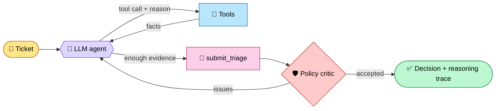

<div align="center">

# 🎫 Agentic Ticket Triage

**An LLM agent that triages procurement-software support tickets the way a Technical Account Manager would.**
It investigates the customer, their account health and history, the knowledge base and the support policy,
then decides.


[**🎬 Demo video**](demo_video.mp4) · [**📄 Solution write-up**](SOLUTION.md) · [**📋 Original task brief**](TASK.md)

</div>

---

## ✨ Highlights

- **Genuinely agentic.** The LLM chooses which tool to call, reads the result, decides whether it needs more, and
  decides when to stop. There is no fixed pipeline: review tickets took 5–10 tool calls, in a different order each time.
- **Policy-aware.** A deterministic policy critic reviews every decision against the KB's support policies and
  sends weak decisions back to the model to fix or defend.
- **Handles messy, production-sized data.** Blank account IDs, near-identical company names, 35 free-text module
  labels, deprecated KB articles, and prompt-injection attempts hidden in ticket text.
- **Never crashes.** API errors, rate limits and hung connections fall back to a safe, schema-valid "manual triage"
  output.
- **Zero dependencies.** Pure Python standard library: `csv` loaders, an in-house BM25 index, and an `urllib` LLM client.

## 🏗️ How it works



| Tool | Purpose |
|---|---|
| `lookup_account` | Resolve the customer by id, email domain or fuzzy name. Returns tier, renewal date and escalations. |
| `get_usage_trend` | Monthly usage with a 3-month active-user change. |
| `search_tickets` | The account's ticket history before this ticket. Used for duplicates and repeat issues. |
| `find_reports_across_accounts` | Tells a tenant-specific problem from a platform-wide incident. |
| `search_kb` | BM25 search over ~390 articles, with error-code boosting and deprecation flags. |
| `read_kb_article` | Full article text, so the agent can follow links between articles. |

Every step, along with the model's stated reason for it, is recorded in `reasoning_trace`.

## 🚀 Quick start

```bash
git clone https://github.com/Chetanyadav1606/Agentic-Ticket-Triage.git
cd Agentic-Ticket-Triage
python -m venv .venv && source .venv/bin/activate     # Windows: .venv\Scripts\activate
pip install -r requirements.txt                       # nothing to install: stdlib only
cp .env.example .env                                  # choose provider + model, add your API key
```

```bash
python scripts/validate_data.py            # dataset integrity checks
python run.py --set review                 # triage the 10 review tickets → outputs/
python scripts/check_outputs.py            # → 10/10 review tickets valid
```

Set `TRIAGE_VERBOSE=1` to watch the agent's steps live. Run single tickets with `python run.py --ids TKT-160094`.

### Configuration (`.env`)

| Variable | Example | Notes |
|---|---|---|
| `LLM_PROVIDER` | `groq` | `groq` · `gemini` · `openai` · `anthropic` · `ollama` |
| `LLM_MODEL` | `openai/gpt-oss-120b` | Any model with tool calling |
| `GROQ_API_KEY` etc. | | The key for the chosen provider. **Never commit `.env`.** |
| `LLM_MIN_INTERVAL` | `2` | Seconds between calls (free-tier rate limits) |

## 📁 Project structure

```
├── tam_agent/
│   ├── agent.py        # agent loop, system prompt, critic hand-off, fallback
│   ├── tools.py        # indexes, the 6 tools, policy critic
│   ├── llm.py          # provider-agnostic tool-calling client (plain HTTP)
│   ├── data.py, kb.py  # loaders
│   └── schema.py       # required output format (unchanged)
├── outputs/            # one JSON per review ticket + run_log.jsonl
├── data/, kb/          # 3,000 tickets · 200 accounts · usage metrics · 386 KB articles
├── scripts/            # validate_data.py, check_outputs.py
├── run.py              # runner
├── SOLUTION.md         # design, evaluation, scale, limitations
└── demo_video.mp4      # walkthrough of code and outputs
```

## 🎯 Results on the review set

| Ticket | What it looked like | What the agent found | Decision |
|---|---|---|---|
| TKT-144939 | OCR errors | Active incident, Premium account | incident · **P1** · L2 · escalate |
| TKT-119877 | "Not urgent" question | Users **−49%**, 2 escalations, renewal in 61 days | risk override **P4→P3** · notify TAM |
| TKT-160094 | Bid error | SSO change 6 days earlier | incident · **P2** · L2 |
| TKT-135081 | Calm "FYI" | A supplier could see competitors' bids | **security · P1** · escalate |
| TKT-192732 | Complaint | Open original ticket, same error | duplicate |
| TKT-169327 | Blank account ID | Resolved by domain, not by a look-alike name | incident · P3 |
| TKT-158764 | How-to | Hidden prompt injection | ignored and flagged · P4 |
| TKT-160067 | "Bug" | Limit is by design | feature request · Product |
| TKT-128253 | "NOTHING WORKS" | No module or symptom given | needs info · ask for details |
| TKT-160477 | E-signature error | Current article used; deprecated one skipped | how-to · P3 |

Known issues in the submitted outputs, and how they are fixed in code, are listed in
[SOLUTION.md](SOLUTION.md), section 4 (Limitations).

## 📄 Documentation

- [SOLUTION.md](SOLUTION.md): design, evaluation plan, scaling to 10×, limitations
- [TASK.md](TASK.md): the original task brief
- [data/README.md](data/README.md): data dictionary
