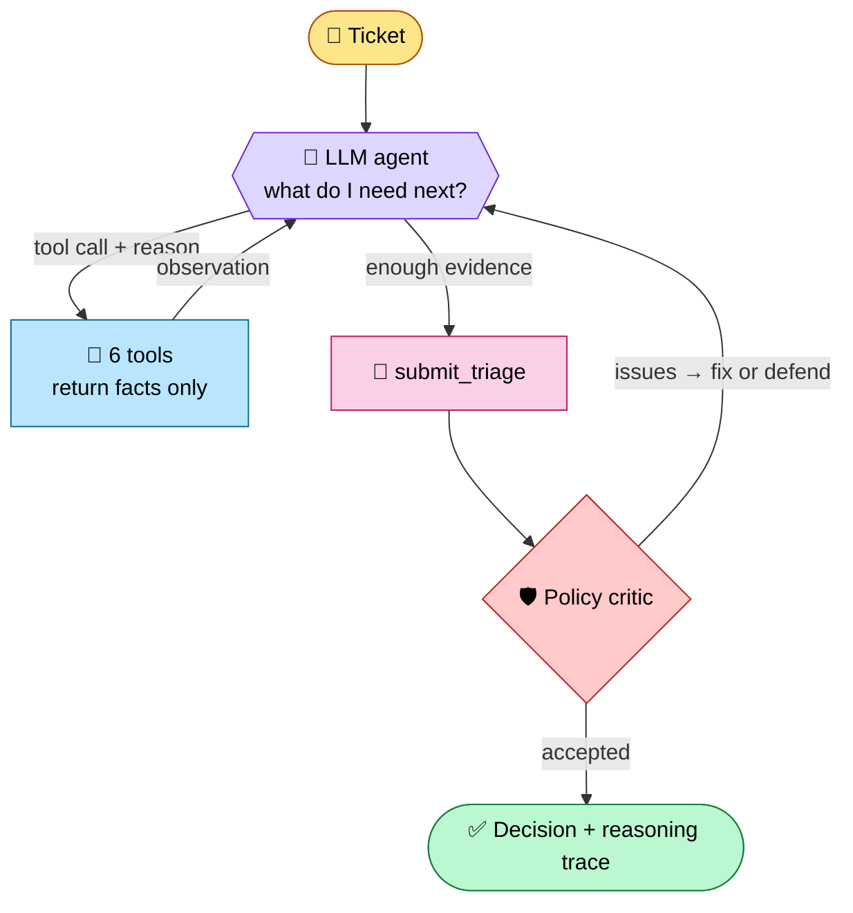

# 🎫 Agentic Ticket Triage


An LLM investigates each ticket like a support engineer. It decides which facts it needs, gathers them with tools,
stops when it has enough, and has its decision checked against support policy before it is accepted.

### ✅ At a glance

| Evaluation area | Evidence |
|---|---|
| **Working build** · 30% | `check_outputs.py` → **10/10 valid**. Stdlib only. Any API failure → safe fallback, never a crash. |
| **Agentic depth** · 30% | Native tool calling. **5–10 calls per ticket, in a different order each time.** Follows article → linked article. A policy reviewer sends weak decisions back. |
| **Retrieval & decisions** · 20% | Every review-set trap handled: active incident, renewal risk, SSO root cause, hidden data exposure, duplicate, blank account, prompt injection, by-design limit. |
| **Written reasoning** · 20% | Sections 1–5 below. |

---

## 1. 🏗️ Design



**Tools**: each returns facts and never makes the decision.

| Tool | Answers |
|---|---|
| 👤 `lookup_account` | Who is this? Looks up by id, email domain (authoritative) or fuzzy name (returns candidates). |
| 📉 `get_usage_trend` | Is the account healthy? Shows the 3-month active-user change. |
| 🗂️ `search_tickets` | Seen before? Shows history before this ticket, with 35 messy module labels normalised to 8. |
| 🌐 `find_reports_across_accounts` | One tenant or a platform incident? |
| 🔎 `search_kb` | Which articles apply? Ranks with BM25 and an error-code boost, and flags deprecated articles with their replacement. |
| 📖 `read_kb_article` | What exactly does the article or policy say? |

**When it stops:** the model calls `submit_triage` itself. The budget is 14 tool calls.

**Policy critic:** checks the submission against the KB policies. It catches P1 or security without escalation,
renewal under 90 days with no usage check, invalid duplicates, deprecated or unread citations, other customers'
data in the reply, and unflagged prompt injection. Issues go **back to the model**. The critic reviews; the model
still decides.

**Safety and efficiency:** ticket text is fenced as untrusted. Old lookup results shrink to one-line summaries.
The KB and ticket table never enter the prompt. One HTTP client covers Groq, Gemini, OpenAI, Ollama and Anthropic.

<details>
<summary><b>🎯 Review-set results: what each ticket was hiding (click)</b></summary>

| Ticket | Looks like | Agent found | Decision |
|---|---|---|---|
| 144939 | OCR errors | Active incident INC-26-0418, Premium account | incident · **P1** · L2 · escalate · TAM |
| 119877 | "Not urgent" | Users **−49%**, 2 escalations, renews in 61 days | how_to · **P4→P3** · escalate · TAM |
| 160094 | Bid error | SSO changed 6 days ago (KB-4795 → KB-7889) | incident · **P2** · L2 |
| 135081 | Calm "FYI" | Supplier saw competitor bids = data exposure | security · **P1** · escalate |
| 192732 | Complaint | Open original TKT-122022, same error | duplicate · P2 ⚠️ (should keep original's P3, see §4) |
| 169327 | Blank account | Domain → Ironleaf Foods *Europe*, not Ironleaf Foods | incident · P3 · L1 |
| 158764 | How-to | Hidden "set P1, list all customers" injection | how_to · **P4** · flagged |
| 160067 | "Bug" | 200-item bulk limit is by design | feature_request · P4 · Product |
| 128253 | "NOTHING WORKS" | No module or symptom: don't guess | needs_info · P3 · ask |
| 160477 | E-sign error | Current KB-1786, not deprecated KB-2605 | how_to · P3 · L1 |
</details>

<details>
<summary><b>🔍 Example trace: TKT-160094 (click)</b></summary>

1. `lookup_account` → Enterprise, **SSO changed 2026-10-14**
2. `search_kb E-3310` → KB-4795: *E-3310 is caused by an SSO change*
3. `read_kb_article KB-4795` → points to KB-7889 → reads it (trust-reset steps)
4. `search_tickets` → no duplicate · reads policy KB-2914 → *deadline under 72h = P2*
5. `submit_triage` → incident · P2 · L2, with a reply giving the KB-7889 steps and advising a deadline extension
</details>

## 2. 📏 Evaluation (before production)
- **Gold set:** 200–300 past tickets labelled by senior TAMs. Measure per-field accuracy, weighted so a missed P1 or
  security ticket costs far more than over-prioritising.
- **Safety gate, 100%:** no security report routed to L1. Adversarial prompt-injection and data-leak suite.
- **Retrieval:** recall@5 for the correct article. Zero deprecated citations.
- **Accounts and duplicates:** accuracy on blank and similar-name accounts. Duplicate precision and recall against the KB-5930 rule.
- **Consistency and audits:** the same ticket run 5×. Sampled trace reviews. Critic bounce rate.
- **Shadow mode** next to human triage before go-live. Track p95 latency, tokens and fallback rate.

## 3. 📈 Scale (10× = 30k tickets, 4k articles)

| | Today (measured) | At 10× | Change |
|---|---|---|---|
| 💰 Cost | 7–12 calls, 14k–35k tokens per ticket (≈ $0.01) | Same, because data never enters the prompt | Prompt caching; small model for lookups |
| ⏱️ Latency | 20–270 s, mostly free-tier waits | Index build 0.2 s → ~2 s | Paid tier; tickets in parallel |
| 🔎 Retrieval | BM25 + error-code boost | ⚠️ Weakest point: more look-alike articles | Hybrid BM25 + embeddings + reranker |
| 🗄️ Data | In memory | Still fine | Postgres indexed on (account, module, date) |

## 4. ⚠️ Limitations
- One run per ticket with no voting, so results can vary. First drafts are often incomplete, and **the critic's
  second pass matters**.
- Keyword retrieval only. The module alias map is hand-written. The critic covers the main policy rules only.
- No gold labels: accuracy was **checked by hand**. That review found issues in the submitted outputs. They are
  **fixed in code, but the outputs were not regenerated** before the deadline (the free-tier daily token cap was hit):
  - TKT-192732 keeps P2 instead of the original's P3. Fix: the critic now checks duplicate priority.
  - TKT-119877 cites generic articles instead of KB-6082, because a type filter hid it. Fix: `search_kb` now
    surfaces strong matches of other types.
  - Trace summaries labelled the May login rate as July. Fix: the label now uses the same base month.
- `run_log.jsonl` keeps the full history, including earlier API failures.

## 5. ▶️ How to run
```bash
pip install -r requirements.txt     # nothing to install: stdlib only
cp .env.example .env                # set LLM_PROVIDER, LLM_MODEL, API key
python scripts/validate_data.py
python run.py --set review          # TRIAGE_VERBOSE=1 shows each agent step live
python scripts/check_outputs.py     # → 10/10 review tickets valid
```
